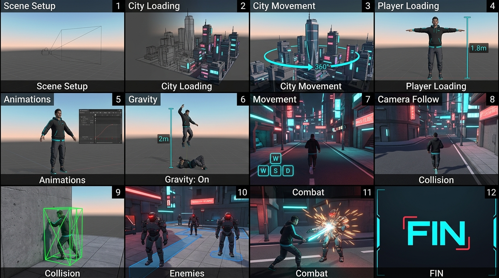

# GTA-Style 3D Game (Three.js)

> A third-person open-world sandbox game built with [Three.js](https://threejs.org/) — no game engine, just pure WebGL.



## Quick Start

```bash
# 1. Install dependencies
npm install

# 2. Start dev server
npm run dev

# 3. Build for production
npm run build

# 4. Preview production build
npm run preview
```

> **Note:** If `npm install` fails, try `npm install --legacy-peer-deps`.

## Controls

| Key | Action |
|---|---|
| **W A S D** | Move (camera-relative) |
| **Shift** | Sprint |
| **Space** | Jump |
| **Mouse** | Look around |
| **Scroll** | Zoom in/out |
| **Left Click** | Attack (when pointer is locked) |
| **E** | Attack |
| **H** | Hit reaction (debug) |
| **F** | Toggle third-person / free-fly camera |
| **Esc** | Release pointer lock |

## Project Structure

```
├── public/assets/          # Static 3D assets (FBX, GLB)
│   ├── city.glb            # City environment model
│   ├── Player.fbx          # Player character mesh
│   ├── Player_Idle.fbx     # Idle animation
│   ├── Player_Walk.fbx     # Walk animation
│   ├── Player_Run.fbx      # Run animation
│   ├── Player_Jumping_Up.fbx
│   ├── Player_Jumping_Down.fbx
│   ├── Player_hit.fbx      # Hit reaction animation
│   ├── Enemy.fbx           # Enemy character mesh
│   ├── Enemy_Walk.fbx      # Enemy walk animation
│   └── Enemy_Fall.fbx      # Enemy death animation
├── src/
│   └── main.js             # All game code (1283 lines)
├── assets/                 # Duplicate of public/assets (backup)
├── index.html              # HTML entry point
├── style.css               # UI overlay styles
├── package.json            # Node dependencies
└── 3D_Game_Demo_Storyboard_202606161024.jpeg
```

## Features

- **3D City** — Loads `city.glb` or procedurally generates ~400 buildings
- **Player Character** — Third-person view, 6 animation states (idle, walk, run, jump, fall, hit)
- **Animation State Machine** — Crossfading between animations with priority logic
- **Third-Person Camera** — Smooth follow cam with yaw/pitch/zoom, plus free-fly mode
- **Physics** — Gravity (28 m/s²), jumping, wall collision via raycasting
- **Enemy NPCs** — 15 patrol enemies with waypoint AI, player detection, building avoidance
- **Combat** — Attack cone (3 units, 60°), damage system, knockback, death animations
- **Pointer Lock** — Click-to-play overlay with control instructions

---

# Step-by-Step Build Guide

This game was built in **11 sequential steps**, each adding a core feature. Follow them in order to rebuild from scratch.

## Step 1: Scene Setup
**Files:** `src/main.js` (step1_sceneSetup)

- Create a `THREE.Scene` with sky-blue background and fog
- Set up a `WebGLRenderer` with antialiasing, shadows, sRGB color space
- Add a `PerspectiveCamera` (70° FOV, 0.1–2000 clipping)
- Add lighting: `AmbientLight` (0.55), `DirectionalLight` (1.2, shadows), `HemisphereLight`
- Add a giant ground plane (2000×2000) as a floor
- Handle window resize

```js
const scene = new THREE.Scene();
scene.background = new THREE.Color(0x87ceeb);
scene.fog = new THREE.Fog(0x87ceeb, 80, 400);

const renderer = new THREE.WebGLRenderer({
  canvas: document.getElementById('game-canvas'),
  antialias: true,
});
renderer.shadowMap.enabled = true;
renderer.shadowMap.type = THREE.PCFSoftShadowMap;
```

## Step 2: Load / Generate the City
**Files:** `src/main.js` (step2_city, buildProceduralCity)

- Try to load `city.glb` via `GLTFLoader`
- If missing: procedurally generate a city grid:
  - Two perpendicular roads crossing at origin
  - 4 quadrants × 10×10 buildings with random sizes
- Enable shadows on all meshes

## Step 3: City Movement (Orbit Controls)
**Files:** `src/main.js` (step3_cityMovement)

- Implement pointer lock on canvas click
- Free-orbit camera controlled by mouse (theta/phi/distance spherical coords)
- Scroll wheel to zoom (5–200 units)
- This gives you a flyover view of the city

## Step 4: Load the Player
**Files:** `src/main.js` (step4_player)

- Load `Player.fbx` via `FBXLoader`
- Auto-scale to 1.8m height using AABB
- Shift position so feet rest at y=0
- Fix missing textures (assign skin tone color)
- Enable shadows on player meshes

## Step 5: Player Animations & State Machine
**Files:** `src/main.js` (step5_animations, AnimationStateMachine)

- Load 6 animation clips: idle, walk, run, jump, fall, hit
- Strip `.position` tracks to prevent root motion
- Create an `AnimationStateMachine` class with:
  - `setState(next, options)` — crossfade between animations (0.18s)
  - `update({isMoving, isSprinting, isGrounded, verticalVelocity, hit})` — priority logic:
    1. Hit (blocking, highest priority)
    2. Airborne (jump / fall based on vertical velocity sign)
    3. Grounded (sprint → walk → idle)

## Step 6: Gravity
**Files:** `src/main.js` (step6_gravity)

- Apply 28 m/s² downward acceleration each frame
- Compute foot offset from player AABB
- Clamp player y-position to ground level when feet touch

```js
shared.velocityY -= 28 * delta;
player.position.y += shared.velocityY * delta;
// Clamp to ground
if (footY <= 0) {
  player.position.y -= footY;
  shared.velocityY = 0;
}
```

## Step 7: Movement Controls
**Files:** `src/main.js` (step7_movement, KeyboardInput)

- Build a `KeyboardInput` class tracking held keys + just-pressed keys
- WASD = camera-relative movement (6 units/s walk, 11 units/s sprint)
- Space = jump (impulse 11 upward, only when grounded)
- Smooth rotation toward movement direction (max 14 rad/s)
- Handle blur event (reset all keys)

## Step 8: Third-Person Camera Follow
**Files:** `src/main.js` (step8_cameraFollow)

- Create "Click to Play" overlay with control instructions
- **Third-person mode**: exponential smoothing (lerp factor 14) behind player based on yaw/pitch/distance, camera looks at player waist
- **Free-fly mode**: WASD moves the camera itself in world direction
- Toggle between modes with **F** key
- Smooth exponential interpolation: `1 - exp(-14 * delta)`

## Step 9: Collision Detection
**Files:** `src/main.js` (step9_collision)

- Compute city boundary AABB (with 2-unit padding)
- Use `THREE.Raycaster` for wall collision:
  - Cast ray from previous to current position
  - Exclude player and enemy meshes
  - Push player back from wall surface minus radius (0.35)
- Clamp player to city boundary
- Store previous position each frame

## Step 10: Enemy NPCs with AI
**Files:** `src/main.js` (step10_enemies, EnemyNPC)

- Create an `EnemyNPC` class per enemy:
  - Random position in a ring (5–55 units from center)
  - 3–6 waypoints avoiding buildings, within 60-unit patrol radius
  - Patrol speed 2.5–4, health 2–3
- Load `Enemy.fbx` mesh + `Enemy_Walk.fbx` (looping) + `Enemy_Fall.fbx` (one-shot death)
- **AI states**: Idle → Walk (patrol) → Chase (when player within 12 units)
- Building avoidance steering, minimum 1.5-unit distance from player
- Performance: skip frames for distant enemies (5 out of 6)

## Step 11: Combat System
**Files:** `src/main.js` (step11_enemyCombat)

- Attack range: 3 units, 60° cone in front of player
- Damage: 1 hit point per attack
- Triggers: **E key** or **left-click** (when pointer locked)
- On hit: `takeDamage(1, playerPos)` on closest enemy in cone
- Knockback: push enemy 2.5 units away from attacker
- Death: play `Enemy_Fall.fbx`, remove from scene after clip finishes
- Visual feedback: enemy flashes red for 0.3s

---

# 3D Game Demo Storyboard

This storyboard maps the **complete game development journey** — from empty canvas to playable GTA-style sandbox.

```
ACT 1: FOUNDATION
═══════════════════

  Scene 1 — Blank Canvas
  ┌─────────────────────────────────────────┐
  │  Three.js scene with a camera and light │
  │  Nothing else. Empty blue sky.          │
  └─────────────────────────────────────────┘
  → Step 1: Scene Setup

  Scene 2 — A City is Born
  ┌─────────────────────────────────────────┐
  │  Buildings rise from the ground. Roads  │
  │  carve the grid. A tiny world appears.  │
  └─────────────────────────────────────────┘
  → Step 2: Load / Generate City

  Scene 3 — You Can Look Around
  ┌─────────────────────────────────────────┐
  │  Mouse controls the camera. You orbit   │
  │  around your new city like a drone.     │
  └─────────────────────────────────────────┘
  → Step 3: City Movement / Orbit Controls


ACT 2: THE PROTAGONIST
═══════════════════════

  Scene 4 — A Figure Appears
  ┌─────────────────────────────────────────┐
  │  A character materializes at the center │
  │  of the city. It's you.                 │
  └─────────────────────────────────────────┘
  → Step 4: Load Player

  Scene 5 — Coming to Life
  ┌─────────────────────────────────────────┐
  │  Idle → Walk → Run → Jump → Fall → Hit │
  │  The character moves, breathes, reacts. │
  └─────────────────────────────────────────┘
  → Step 5: Animations & State Machine

  Scene 6 — Down to Earth
  ┌─────────────────────────────────────────┐
  │  Gravity kicks in. Jump and fall back   │
  │  to the ground. The world feels real.   │
  └─────────────────────────────────────────┘
  → Step 6: Gravity

  Scene 7 — Taking Control
  ┌─────────────────────────────────────────┐
  │  WASD to stride the streets. Shift to   │
  │  sprint. Space to leap. You're free.    │
  └─────────────────────────────────────────┘
  → Step 7: Movement Controls


ACT 3: THE WORLD INTERACTS
═══════════════════════════

  Scene 8 — The Camera Follows
  ┌─────────────────────────────────────────┐
  │  The camera hugs your shoulder. Third-  │
  │  person view locks in behind you.       │
  └─────────────────────────────────────────┘
  → Step 8: Camera Follow

  Scene 9 — Hitting Walls
  ┌─────────────────────────────────────────┐
  │  You can't walk through buildings. Ray  │
  │  collision pushes you back. Boundaries. │
  └─────────────────────────────────────────┘
  → Step 9: Collision Detection

  Scene 10 — You Are Not Alone
  ┌─────────────────────────────────────────┐
  │  Enemies patrol the streets. They roam, │
  │  they notice you, they chase.           │
  └─────────────────────────────────────────┘
  → Step 10: Enemy NPCs with AI

  Scene 11 — Fight!
  ┌─────────────────────────────────────────┐
  │  E to punch. Click to strike. Enemies   │
  │  flinch, fly back, fall dead. Combat.   │
  └─────────────────────────────────────────┘
  → Step 11: Combat System


ACT 4: WHAT COMES NEXT (Roadmap)
═════════════════════════════════

  Scene 12 — Health & UI
  ┌─────────────────────────────────────────┐
  │  Health bars, damage numbers, mini-map, │
  │  crosshair, ammo counter, quest log.    │
  └─────────────────────────────────────────┘

  Scene 13 — Weapons
  ┌─────────────────────────────────────────┐
  │  Melee weapons → Pistol → Rifle → Rocket│
  │  Muzzle flash, projectiles, explosions. │
  └─────────────────────────────────────────┘

  Scene 14 — Vehicles
  ┌─────────────────────────────────────────┐
  │  Cars, bikes, planes. Enter/exit,       │
  │  physics-based driving, honk, drift.    │
  └─────────────────────────────────────────┘

  Scene 15 — Missions
  ┌─────────────────────────────────────────┐
  │  Story missions, side quests, NPC       │
  │  dialog, objectives, rewards, progress. │
  └─────────────────────────────────────────┘

  Scene 16 — Audio
  ┌─────────────────────────────────────────┐
  │  Footsteps, ambient city sounds,        │
  │  engine roars, gunshots, radio music.   │
  └─────────────────────────────────────────┘

  Scene 17 — Polish & Ship
  ┌─────────────────────────────────────────┐
  │  Loading screen, main menu, save/load,  │
  │  performance optimization, packaging.   │
  └─────────────────────────────────────────┘
```

## Build Roadmap

| Phase | Feature | Status |
|---|---|---|
| **1** | Scene, Renderer, Camera, Lighting | ✅ Done |
| **2** | City (GLB / Procedural) | ✅ Done |
| **3** | Orbit Controls / City Tour | ✅ Done |
| **4** | Player Character | ✅ Done |
| **5** | Animation State Machine | ✅ Done |
| **6** | Gravity Physics | ✅ Done |
| **7** | WASD Movement + Jump | ✅ Done |
| **8** | Third-Person Camera | ✅ Done |
| **9** | Wall Collision | ✅ Done |
| **10** | Enemy NPC AI | ✅ Done |
| **11** | Combat System | ✅ Done |
| **12** | Health & UI HUD | ⏳ Next |
| **13** | Weapons System | 📅 Planned |
| **14** | Vehicles | 📅 Planned |
| **15** | Missions & Story | 📅 Planned |
| **16** | Audio System | 📅 Planned |
| **17** | Polish, Menu, Save/Load | 📅 Planned |

## Tech Stack

- **Three.js r184** — 3D rendering engine
- **Vite 8** — Dev server and build tool
- **JavaScript (ES Modules)** — No TypeScript
- **FBX / GLB** — 3D model formats
- **No game engine** — Everything is custom-built on raw WebGL

## License

MIT


## Apollo narration

The intro is generated through ElevenLabs from `APOLLO_DIALOGUE.intro` in
`src/apollo-dialogue.mjs`. The old `Apollo Intro.mp3` and estimated caption JSON are
no longer loaded by the game. The generated audio drives progressive text captions.
Apollo uses one voice ID, `APOLLO_VOICE` in `server/alien-voice.mjs`, for the intro,
conversation lines and mission announcements.
Announcements wait for the conversation channel to become free. Pause and mute apply
to all voices, and Apollo's companion animates only for his own audio.

## Spoken alien dialogue (ElevenLabs)

Player questions now require speech verification. Press **E** near a farmer to talk,
then **V** to enable the microphone. Read the displayed player line and pause briefly
for ElevenLabs to finalize the transcript. Incorrect words keep the same line locked;
Apollo shows what was heard and asks you to repeat the whole sentence. A matching completed attempt
automatically displays and dubs the alien's reply without an Apollo confirmation. A question
can span multiple speech segments. Press **V** again to cancel and retry.

Matching ignores case/punctuation and expands common contractions; it requires all
words in order, including negations. It does not score pronunciation. Microphone and
network errors offer a retry without advancing the mission. The microphone is closed
on pause, tab switching, walking away, or destroying the conversation. Muting playback
does not disable speech recognition. Each attempt has a 45-second inactivity/session limit.

The server loads `ELEVENLABS_API_KEY` from the onboarded `.env.local` file. Restart
`npm run dev` after this change so Vite installs the `/api/scribe-token` endpoint.
Both `npm run dev` and `npm run preview` provide this server-side endpoint locally;
only single-use Scribe tokens are returned to the browser. Microphone access requires
localhost or HTTPS. Attempts use ElevenLabs speech-to-text credits.

A static-only deployment cannot mint tokens. For public deployment, host
`server/scribe-token.mjs` behind an authenticated server route at `/api/scribe-token`,
with the key in server secrets. Preserve the origin checks, no-store headers and rate
limit, and add your deployment's user authentication. Never put the key in a `VITE_`
variable or in client code.


## Dubbed farmer replies

Iri, Vela, and Naru now speak their displayed replies through ElevenLabs, using
George, Sarah, and Daniel respectively. The server uses Flash v2.5 and caches each
voice/text pair in memory for the current server session, including simultaneous
requests for the same clip. Only the game's scripted alien replies can be generated.
The mappings can be changed in `server/alien-voice.mjs`.

Restart the dev server to enable `/api/alien-voice`. After a spoken player question
is verified, the reply plays automatically. E advances later lines after the current voice finishes.
Pause/resume and mute affect the dubbed audio; leaving a conversation stops it.
If generation or playback fails, the text stays visible and E continues normally.
First-time generations use ElevenLabs text-to-speech credits. No live speech was
generated during implementation tests. For public hosting, deploy this server route
alongside the Scribe route with the same authenticated access as described above.


All dubbing now uses `/api/dialogue-voice` (the older `/api/alien-voice` alias remains
compatible). Apollo mission updates are queued rather than interrupting conversations.
Verification feedback is text-only; incorrect attempts can immediately be retried with V.
First generation of each voice/text pair uses ElevenLabs credits; repeats are cached
for the current server session. A static deployment still requires the authenticated
server endpoint described above. Restart `npm run dev` after updating this integration.


Correct spoken player lines now automatically display and dub the alien's response.
There is no Apollo confirmation or extra E press after verification. Incorrect attempts
stay on the same player line with visible corrections; press V to repeat immediately.
Verification feedback is text-only. E still advances later dialogue after its voice ends.


Apollo uses the expressive Eleven v4 model with audio tags: `[laughs]` in the intro
requests performed laughter rather than reading a stage direction. His voice ID stays
the same across all lines; farmers continue to use Flash v2.5. Audio cache keys include
the model so a Flash rendering cannot be reused for an expressive Apollo line.


## Fast dialogue and stable Apollo captions

Press **Enter** while a voice is loading or playing to stop that voice
and reveal the complete current message. The first press completes the text without advancing;
press Enter again to continue. Apollo announcements keep their conversation lock until
that completed text is dismissed. Player speech-verification lines cannot be skipped.

Apollo audio now requests ElevenLabs character timing alongside the generated speech.
Caption pages change only at real sentence boundaries, and words follow provider timing.
The fallback captioner also keeps sentences intact and does not rescale an active
message when browser duration metadata changes. Restart the dev server to enable the
updated timed-audio response.


Objective-panel updates are text-only and no longer enqueue Apollo narration. His
conversation acknowledgement does not read the objective list aloud. The initial
objective hint omits the previous "Peaceful contact only" prefix.
